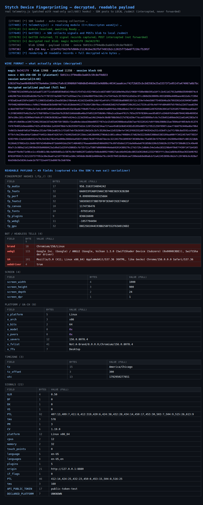

# Stytch Device Fingerprinting (DFP) — Client-Side Red Team

**Executive write-up · 2026-10-25 · authorized, own-stack only · no customer /
prod traffic touched**

> **One line:** A Stytch (Twilio) DFP SDK ships its device-intelligence telemetry
> encrypted with AES-256-CBC under a **per-session key that the client itself
> stores XOR-obfuscated in its own heap** — we recovered that key, decrypted
> real payloads, read the full browser-tell schema, and built a working
> **tamper-and-reseal** proof of concept. The per-request nonce blocks verbatim
> replay but not live tampering; the real boundary has to be server-side.

---

## What we accomplished

1. **Reversed the SDK's protection end-to-end.** The public
   `https://elements.stytch.com/telemetry.js` is C++/Emscripten compiled to
   **wasm2js** (no separate `.wasm`). We mapped its full pipeline: signal
   collection → serialization → **AES-256-CBC** → base64 POST to `/submit`.
2. **Recovered the exact crypto and wire format.**
   ```
   wire blob   = [ 64B session material ][ 16B nonce = AES-256-CBC IV (plaintext) ][ AES-256-CBC ct ]
   AES-256 key = HEAPU8[C+96..C+128] XOR HEAPU8[8304..8336]   where C = u32(HEAPU8[17349*4])
   plaintext   = magic(8e3421f0) | 64B session block | serialized telemetry | PKCS#7
   ```
3. **Decrypted real payloads** — verified on many runs by the `8e3421f0` magic.
4. **Recovered the readable payload.** Via the module's own `dd()` string
   decoder (301 decoded field names) and its `sa()` serializer hook, we dumped
   the actual shipped fields: `fp_*` hashes (audio / canvas / fonts / webgl /
   gpu), `webdriver`, `webgl`, `UA`, `brand`, `x_*` UA-CH, screen, timezone,
   and bot/tamper signals.
5. **Built a working tamper-and-reseal PoC** — intercept the POST, read the key
   from the heap, decrypt, modify the plaintext, re-encrypt with a **fresh**
   nonce, reship. Server-side re-decrypt confirms the tampered payload arrives
   intact (`magic 8e3421f0 · payload[0:16] = "TAMPERED_PAYLOAD"`).

## How we did it (methodology)

- **Runtime instrumentation (Playwright + `addInitScript`):** hooked
  `SubtleCrypto`, `fetch`, `getRandomValues` (to force determinism for
  differential analysis), the Emscripten string bridge, and the emval bridge —
  capturing the full ordered input stream (97 events) and heap snapshots at
  key moments.
- **Static RE of the wasm2js bundle:** located the AES S-box/Rcon tables,
  the `de()` key-schedule, the `dd()` string decoder, the `sa()` serializer,
  the `V()` constant decoder, and the base64 → fetch path.
- **Differential cryptoanalysis:** with randomness forced, blobs became
  deterministic — isolating the 16-byte plaintext nonce at header offset 64 and
  the true ciphertext start (offset **80**, not 112).
- **Key recovery:** the module stores its own AES key XOR-masked against a
  256-byte table at heap offset 8304. `C+96 XOR table8304[0..31]` yields the
  real key — confirmed by successful decryption.
- **Schema recovery:** hooked `dd()` (constants → names) and `sa()`
  (name → value), giving the readable payload without parsing the custom wire
  record format.

## What it proves

- The **client holds everything needed to read and rewrite its own telemetry**:
  key material, nonce, and format are all recoverable from the page's own
  memory and network — there is no server secret in the client.
- The **per-request nonce only blocks verbatim replay**. It does **not** block
  live tamper-and-reseal, because the nonce isn't secret and the key is
  recoverable per session.
- Device-intelligence signals shipped by DFP SDKs are **spoofable at the
  client** by a determined actor: `webdriver`, fingerprint hashes, UA, and
  device identity can all be altered before the server sees them.

## How this could be (ab)used

Defensive framing — the same capability an attacker would use:

1. **Evading device reputation** — rewrite `webdriver → false`, change
   `fp_webgl`/`fp_canvas`/`fp_gpu` hashes, spoof `UA` so the fingerprint no
   longer matches the flagged device.
2. **Device-identity minting** — present a fresh device per request to fragment
   device-history correlation (same capability demonstrated on the Signifyd
   `device_id` in the sibling repo).
3. **Payload laundering / replay** — capture a "clean" payload and re-seal it
   under fresh nonces to launder reputation; combine with fresh IP/TLS to look
   like a new, clean device.
4. **Telemetry suppression** — decrypt, blank specific tell fields, re-encrypt,
   ship; the server can't tell the client lied without independent signals.

### The durable boundary (what actually defends)

- **Server-side corroboration:** TLS/JA3/IP/header consistency against the
  claimed payload; a claim of `webdriver=false` from a known datacenter IP is
  already suspicious.
- **Server-issued, per-request state:** challenge nonces / HMACs over
  server-known data that the client must incorporate — kills pure replay and
  makes re-seal require solving the challenge each time.
- **Device-history + behavioral signals:** velocity, account history, and
  interaction patterns that can't be fully forged client-side.
- **Never base a risk verdict solely on client-supplied fingerprints** — treat
  them as corroboration, not truth.

## Honesty / scope notes

- Authorized red-team on the user's own stacks; **public SDK only**, dummy token
  (`public-token-test`), local submit URLs — **no telemetry ever reached
  Stytch**.
- The key is **per-session** (recovered from that run's own memory), **not** a
  static server secret; replay is genuinely blocked by the fresh nonce. We are
  **not** claiming a specific fraud verdict can be forged — we prove the
  *client-side* payload is readable and rewritable.

## See it live — screenshot of the full payload



*Full-page capture of `scripts/stytch-dfp-payloadview-visual.mjs` (visible-browser demo): the decrypted wire format (magic `8e3421f0` · 64B session · plaintext nonce · full serialized hex) followed by all 49 readable payload records with the bot/headless tells highlighted. A fresh `1280B → AES-256-CBC → decrypt` run every time.*

## What each field means

| Field | Meaning |
|---|---|
| **Fingerprint hashes (`fp_*`)** | |
| `fp_audio` | Audio-context fingerprint hash (OfflineAudioContext sample hashing) |
| `fp_feats` / `fp_feats2` | Browser-feature hashes (32-hex) |
| `fp_perf` | Performance-timing derived value |
| `fp_canvas` | Canvas 2D fingerprint hash |
| `fp_fonts` | Font-detection fingerprint hash |
| `fp_plugins` | Plugins fingerprint |
| `fp_webgl` | WebGL fingerprint hash |
| `fp_gpu` | GPU / WebGL-renderer hash (32-hex) |
| **Bot / headless tells** | |
| `webdriver` | `navigator.webdriver` — `true` = automated browser ⚠️ |
| `brand` | UA brand string, e.g. `Chromium/156/Linux`, `HeadlessChrome/…` ⚠️ |
| `webgl` | WebGL renderer string — `SwiftShader` = software/headless GL ⚠️ |
| `UA` | Full `navigator.userAgent` ⚠️ |
| **Screen** | |
| `screen_width/height` | `screen.width/height` |
| `screen_depth` | `screen.colorDepth` |
| `screen_dpr` | `window.devicePixelRatio` |
| **Platform / UA-CH (`x_*`)** | |
| `x_platform` | `navigator.platform` (`Linux x86_64`) |
| `x_arch` | UA-CH `architecture` (`x86`) |
| `x_bits` | UA-CH `bitness` (`64`) |
| `x_model` / `x_pvers` | UA-CH `model` / `platformVersion` (empty on desktop) |
| `x_uavers` | UA-CH `uaFullVersion` (`156.0.8078.4`) |
| `x_fvlist` | UA-CH `fullVersionList` brands |
| `x_ffs` | UA-CH `formFactors` (`Desktop`) |
| **Timezone** | |
| `tz` / `tz_offset` / `utc` | IANA zone, offset in minutes, epoch-ms timestamp |
| **Signals** | |
| `GLR` | GL renderer version |
| `DF` / `DX` / `VS` | Boolean flag signals (observed `0`; exact meaning not decoded) |
| `PTL` | Page-timing profile, `eventId:duration` pairs (two rounds) |
| `tms` | Timing in ms (two rounds) |
| `PM` | Page metric (observed `3`; not decoded) |
| `CV` | SDK client version (`1.19.0`) |
| `platform` | `navigator.platform` string |
| `cpus` | `navigator.hardwareConcurrency` |
| `memory` | `navigator.deviceMemory` (GB) |
| `touch_points` | `navigator.maxTouchPoints` |
| `language` / `languages` | Locale(s) |
| `plugins` | `navigator.plugins.length` |
| `origin` | Page origin |
| `if_flags` | Iframe-related flags (observed `0`; not decoded) |
| `API_PUBLIC_TOKEN` / `DECLARED_PLATFORM` | Config passed to `GetTID` in the demo |

Marked ⚠️ = the classic headless/bot tells a fraud engine keys on — and the exact records the tamper PoC can flip before re-sealing with a fresh nonce. `DF/DX/VS/PM/if_flags` values are shown as-is; their exact semantics were not decoded.

## Repo layout & quick run

```
STYTCH_DFP_RECON_2026_10_25.md   the full technical writeup (§9g decrypt,
                                 §9h tamper PoC, §9i readable payload, §10 limits)
scripts/                         all stytch-dfp-*.mjs + stytch_dfp_decrypt.py +
                                 fetch/patch scripts for the real bundle
artifacts/                       curated outputs (payloadview.json, decrypted
                                 body, keys, tamper/vis blobs) + MANIFEST.md
```

```bash
npm install                      # playwright (browser binary already cached)
bash scripts/fetch_and_patch_stytch.sh && python3 scripts/patch_stytch_bundle.py
node scripts/stytch-dfp-final.mjs        # capture key material + blob
python3 scripts/stytch_dfp_decrypt.py    # decrypt (magic 8e3421f0)
node scripts/stytch-dfp-payloadview.mjs  # readable payload
node scripts/stytch-dfp-tamper.mjs --dump# tamper-and-reseal, print payload
```
